<div align="center">

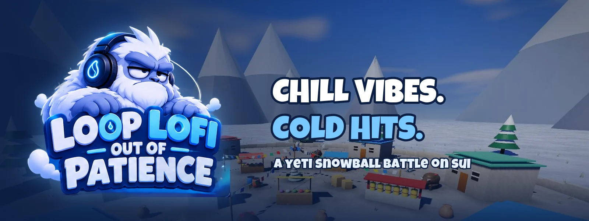

# LOOP: Lofi Out Of Patience

**Chill vibes. Cold hits.**<br/>
A free yeti snowball battle high in the Himalayas, where your yeti is a Sui NFT that keeps its own stats.

[](https://suiscan.xyz/devnet/object/0xcf6bea687cb7c47f0cf5e27df27f2b849223bec37a9fe91b23e2f310029b1e9a)
[](#on-sui)
[](#on-sui)
[](#the-move-package)
[](#tech-stack)
[](#credits)

### [Play now](https://loop-lofi.vercel.app/game) &nbsp;&nbsp;|&nbsp;&nbsp; [Landing](https://loop-lofi.vercel.app) &nbsp;&nbsp;|&nbsp;&nbsp; [Package on Suiscan](https://suiscan.xyz/devnet/object/0xcf6bea687cb7c47f0cf5e27df27f2b849223bec37a9fe91b23e2f310029b1e9a)

Demo video: coming soon

</div>

---

## What is LOOP

> Lofi was frozen in Himalayan ice for millennia. He woke up chill. Now he is out of patience.

LOOP is a fast 8 player arena game that runs in your browser. You play as Lofi and his yeti crew, throwing snowballs and ice bombs across six Himalayan maps, from Everest Base Camp to the ice cave where Lofi slept for a thousand years.

Under the hood it runs on **Sui**. Sign in with Google and you get a real Sui wallet through zkLogin. Mint your yeti as an NFT for free. Every online match you play is signed by the game server and written to your NFT on chain. No seed phrase, no extension, no SUI needed.

Built for **CLAY (Code Like A Yeti)**, the Lofi the Yeti hackathon on Sui.

## Screenshots

<table>
  <tr>
    <td width="50%">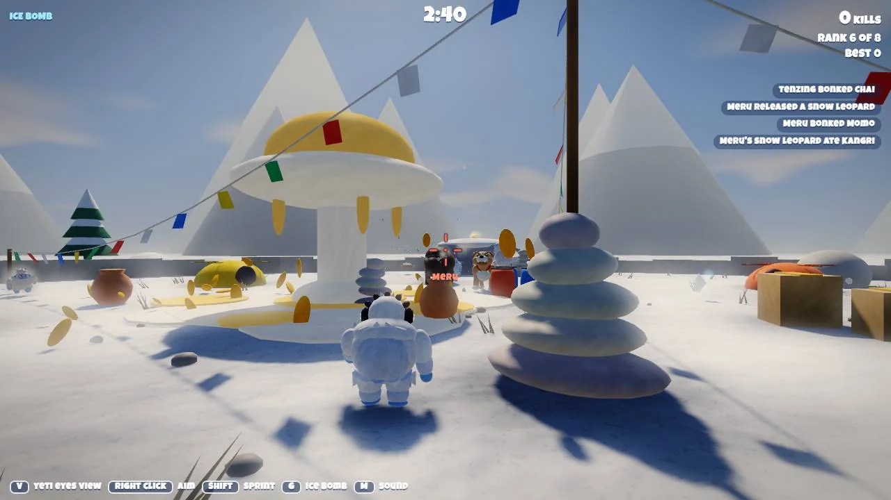</td>
    <td width="50%">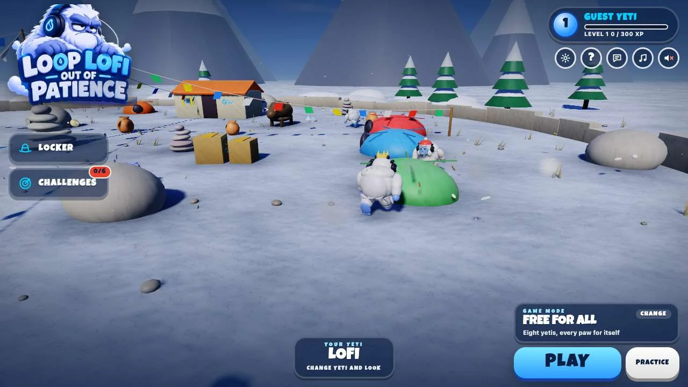</td>
  </tr>
  <tr>
    <td align="center"><sub>Three minute arena matches, 8 yetis, live kill feed</sub></td>
    <td align="center"><sub>Pick a mode, pick a yeti, drop in</sub></td>
  </tr>
  <tr>
    <td width="50%">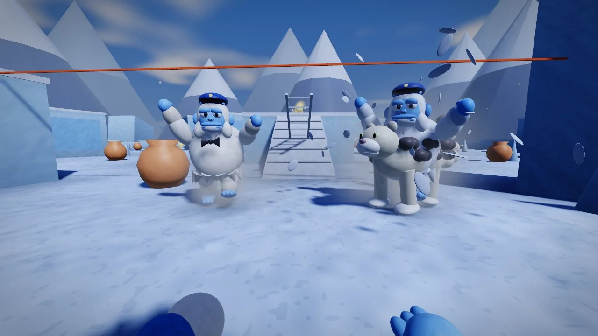</td>
    <td width="50%">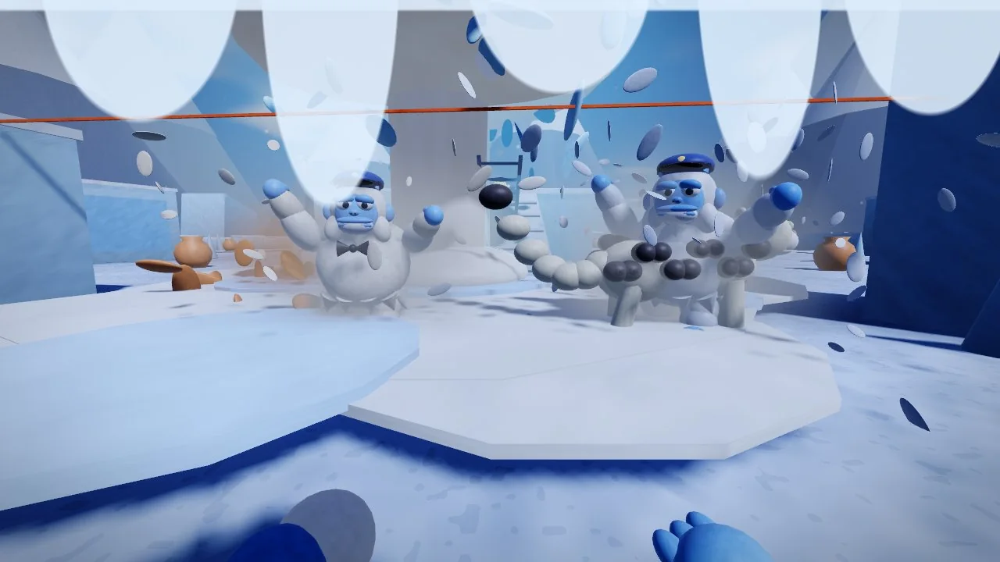</td>
  </tr>
  <tr>
    <td align="center"><sub>4 bonk streak: a snow leopard hunts for you</sub></td>
    <td align="center"><sub>Ice bombs for when they bunch up</sub></td>
  </tr>
  <tr>
    <td width="50%">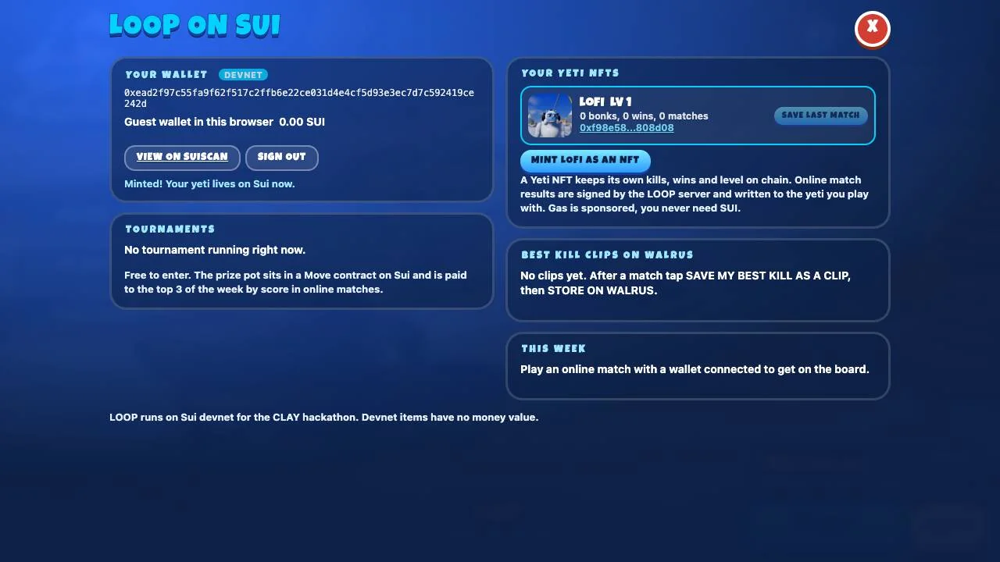</td>
    <td width="50%">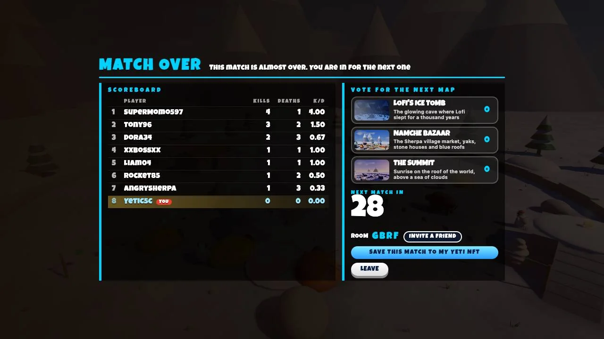</td>
  </tr>
  <tr>
    <td align="center"><sub>LOOP ON SUI: wallet, Yeti NFTs, tournaments, Walrus clips</sub></td>
    <td align="center"><sub>Match over: vote the next map, save the result to your Yeti NFT</sub></td>
  </tr>
</table>

### Six Himalayan maps

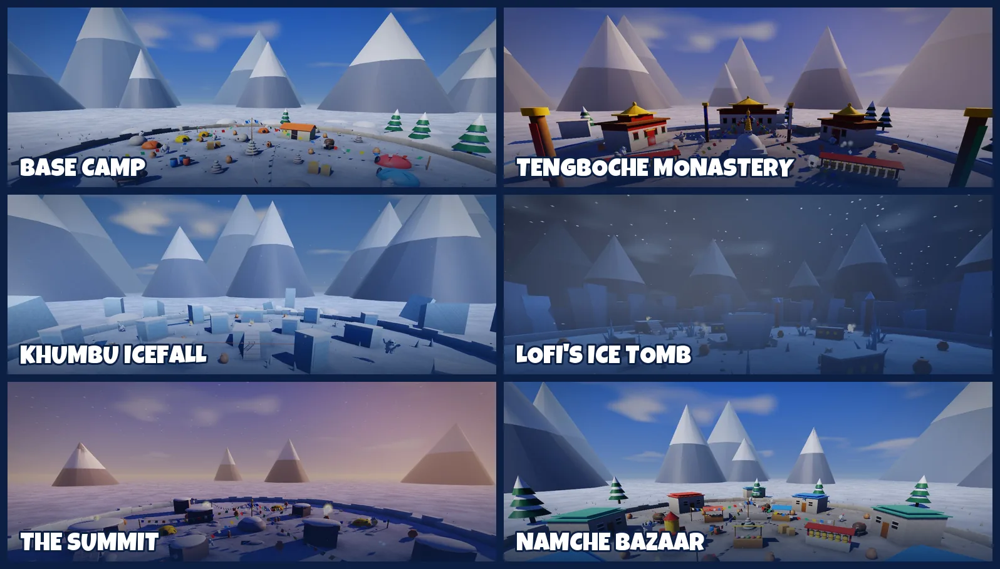

### Eight yetis, each one mintable as a Yeti NFT

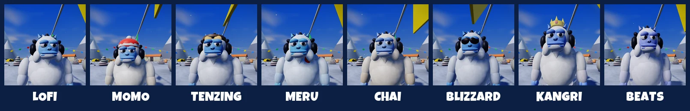

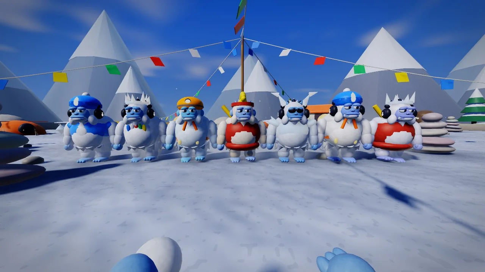

## Features

### The game

- **Modes:** free for all, teams 4 v 4, capture the crystal, and 1 v 1. Three minute matches with 8 players.
- **Online rooms** with room codes and invite links. Bots fill empty seats, so a match always starts.
- **Practice** against bots at three difficulties, plus a one minute training for new players.
- **8 yetis:** Lofi, Momo, Tenzing, Meru, Chai, Blizzard, Kangri and Beats.
- **6 maps:** Base Camp, Tengboche Monastery, Khumbu Icefall, Lofi's Ice Tomb, The Summit and Namche Bazaar. Prayer flags, stupas, yaks, seracs and ladders, with Sui and Lofi logos on the walls.
- **Combat:** hold to throw snowballs, aim for the head for double damage, throw ice bombs into groups.
- **Streaks:** an extra ice bomb at 2, a snow leopard that hunts for you at 4, and an avalanche that buries everyone else at 7.
- **Pickups:** golden snow for rapid fire, ice armor that blocks three hits, and hot momos to heal.
- **Locker:** hats, outfits and ice bomb styles. The rarest ones unlock only with a Yeti NFT, and the very best only when your NFT reaches level 2 or 3.
- **Hand written WebGL2** in one file (`index.html`). No engine, no build step.

### On Sui

| Feature | How it works |
|---|---|
| **zkLogin** | Sign in with Google and get a Sui address, no seed phrase and no extension. The server verifies the Google token and returns a stable salt, and the zero knowledge proof comes from the Mysten prover. A guest wallet is also offered for instant play. |
| **Sponsored gas** | The game server builds every transaction and pays the gas. Players only sign. Nobody needs SUI to play or to mint. |
| **Yeti NFTs** | `yeti::Yeti` stores kills, deaths, wins, matches, xp and level on chain. Online match results are signed (ed25519) by the game server and verified in Move by `record_match`, with a sequence number that blocks replays. Kiosk transfer policy included, so yetis can be traded. |
| **NFT gated cosmetics** | The rarest hats, outfits and ice bombs unlock only for Yeti NFT holders, and the best ones only at NFT level 2 or 3. Playing and saving matches levels up your NFT and unlocks more. |
| **Tournaments** | `tournament::Tournament` is a shared object that holds a SUI prize pot. Entry is free, the organiser funds it, and the top 3 of the week by score are paid out on chain. |
| **Walrus clips** | After a match the game records your best kill as a video clip with sound. Store it on Walrus testnet and mint it as a `clip::Clip` NFT that links to the video. |
| **Owner dashboard** | `admin/` (Google sign in) shows live players and rooms, NFTs minted, the sponsor wallet, the weekly board and on chain activity, and lets the owner create, fund and pay out tournaments. |

## How it works

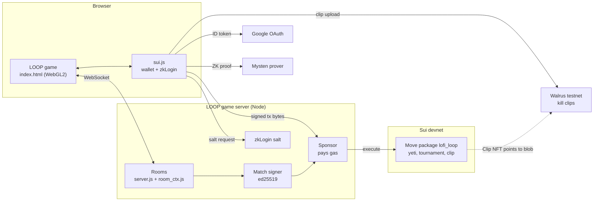

### Save a match to your Yeti NFT

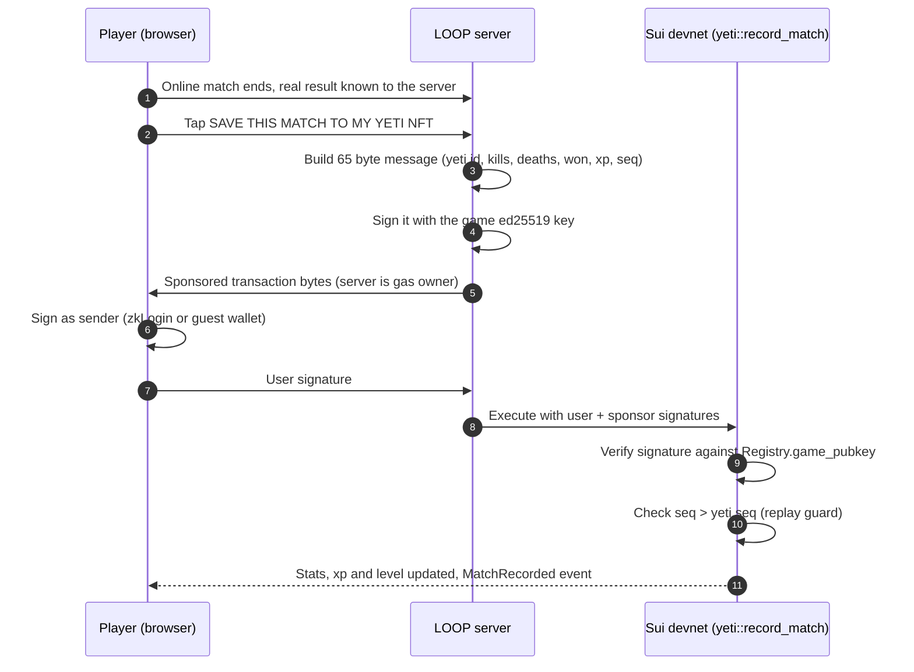

## The Move package

Package `lofi_loop` on Sui devnet (`loop` is a reserved word in Move):

| | id |
|---|---|
| packageId | [`0xcf6bea687cb7c47f0cf5e27df27f2b849223bec37a9fe91b23e2f310029b1e9a`](https://suiscan.xyz/devnet/object/0xcf6bea687cb7c47f0cf5e27df27f2b849223bec37a9fe91b23e2f310029b1e9a) |
| registryId | [`0x3821ca55c4b224abbce059c22299ce6fcd2325229381e234b9caf4d5454cd1be`](https://suiscan.xyz/devnet/object/0x3821ca55c4b224abbce059c22299ce6fcd2325229381e234b9caf4d5454cd1be) |

All public IDs live in [`sui.config.json`](sui.config.json). The full module reference is in [`move/README.md`](move/README.md).

| Module | Main entry functions | What it does |
|---|---|---|
| `yeti` | `mint`, `mint_yeti`, `record_match`, `match_message`, `level_for`, `set_game_pubkey`, `set_base_image`, `create_display` | Free Yeti NFT mint (skin 0..7, name 1..14 characters). Verifies server signed match results and updates kills, deaths, wins, matches, xp and level (`1 + xp/300`, max 100). Display V2 and a Kiosk `TransferPolicy<Yeti>`. |
| `tournament` | `create`, `fund`, `join`, `payout`, `payout_admin`, `sweep` | Shared tournament with a `Balance<SUI>` pot. Free entry within the time window, one payout to the winners, leftover pot swept back to the admin. |
| `clip` | `mint_clip`, `create_display` | Clip NFT holding a Walrus `blob_id`, title, kills and map. Its Display links to the Walrus aggregator. |

`record_match` aborts with `ENoGameKey` if no game key is set, `EStaleSeq` unless `seq > yeti.seq`, and `EBadSignature` if the signature does not verify. The package ships with 20 unit tests, including a fixed signature test vector.

### Signed match result: 65 bytes

The game server signs **raw ed25519** over exactly these bytes. No intent prefix, no hashing. It is identical to BCS of `(address, u64, u64, bool, u64, u64)` and to `yeti::match_message`.

| offset | size | field | encoding |
|---|---|---|---|
| 0 | 32 | yeti object id | address bytes |
| 32 | 8 | kills | u64 little endian |
| 40 | 8 | deaths | u64 little endian |
| 48 | 1 | won | `0x01` or `0x00` |
| 49 | 8 | xp gained this match | u64 little endian |
| 57 | 8 | seq | u64 little endian, must be greater than the yeti's current `seq` |

The public key on chain is `Registry.game_pubkey`, the raw 32 bytes that match `gamePubkeyHex` in `sui.config.json`.

## Try it as a judge

1. Open **https://loop-lofi.vercel.app/game** on a computer (desktop browser, keyboard and mouse).
2. Click **SUI WALLET** in the menu and sign in with Google, or pick the guest wallet.
3. Mint your yeti as an NFT. It is free and the gas is sponsored.
4. Press **PLAY** for an online match. At the end, tap **SAVE THIS MATCH TO MY YETI NFT** and watch the stats change on chain.
5. Save your best kill as a clip and store it on Walrus.
6. Join the **LOOP Launch Cup** on the SUI WALLET page.

## Run it locally

```bash
# the game, single file, no build step
python3 -m http.server 8766
# open http://localhost:8766
```

- **Online server:** `server/` runs the same `index.html` in Node (`server.js`, `room_ctx.js`, `sui.mjs`). Secrets come from environment variables, never from the repo.
- **Move:** see [`move/README.md`](move/README.md). Devnet is wiped about every two weeks, so after a reset run:

```bash
cd move/scripts
./publish.sh      # republish, move caps, set the game key, create Display, rewrite sui.config.json
node e2e.mjs      # live check: mint, signed record_match, tournament and clip
```

Keys live in a gitignored `.secrets/` folder and in server environment variables. Nothing secret is committed.

## Tech stack

- **Game:** hand written WebGL2 and JavaScript in a single HTML file. No engine, no bundler.
- **Server:** Node, running the same game code for online rooms over WebSocket.
- **Chain:** Sui devnet, Move package with `yeti`, `tournament` and `clip`. `@mysten/sui` for zkLogin, sponsorship and reads over gRPC web.
- **Storage:** Walrus testnet for kill clip videos.
- **Auth:** Google OAuth plus the Mysten prover for zkLogin.
- **Hosting:** Vercel for the landing page and the game.

## Repo layout

```
index.html        the whole game (WebGL2, UI, bots, netcode)
sui.js            browser wallet: zkLogin, guest wallet, NFT and tournament calls
sui.config.json   public IDs of the devnet deployment
server/           Node game server: rooms, sponsor, match signer, zkLogin salt, admin API
move/             Move package (yeti, tournament, clip), tests and publish scripts
landing/          landing page
admin/            owner dashboard (Google sign in)
nft/              Yeti NFT images 0.png to 7.png and the clip image
brand/            logo and brand art
docs/             images for this README
```

## Credits

Music by Kevin MacLeod (incompetech.com), licensed under Creative Commons Attribution 4.0. Made in the spirit of Lofi the Yeti (lofitheyeti.com) for the CLAY hackathon. See `CREDITS.md`.

Lofi the Yeti and the CLAY hackathon belong to their creators. LOOP is an independent hackathon entry made in that spirit.

> Everything runs on **Sui devnet** for the hackathon. Devnet items, NFTs and tournament pots have no money value.
